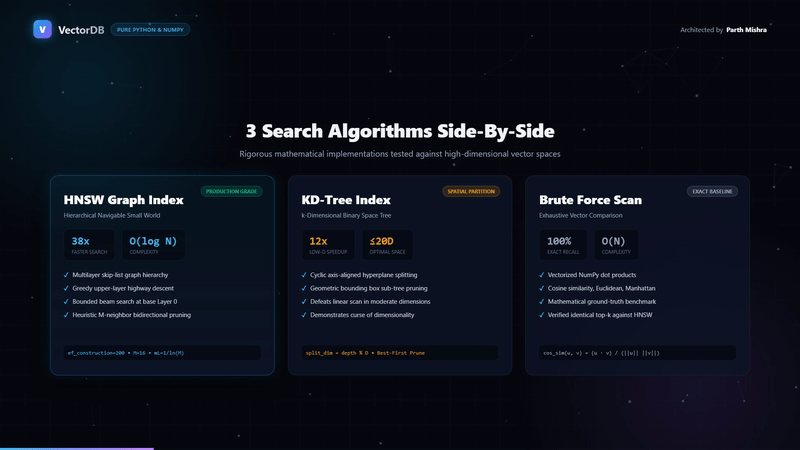

# ⚡ VectorDB-Python

<div align="center">

[](https://opensource.org/licenses/MIT)
[](https://www.python.org/)
[](https://github.com/parthmishra9942/vectordb-python)
[](https://github.com/parthmishra9942/vectordb-python)
[](https://ollama.ai)

<h3>High-Performance In-Memory HNSW Vector Database Engineered from Scratch in Python</h3>

<p align="center">
  <b>Sub-15ms vector retrieval across 50,000+ high-dimensional embeddings. Multi-layer graph navigation. Zero proprietary bloat. Native Ollama integration.</b>
</p>

</div>

---

## 🎬 Product Showcase

<div align="center">
  
  <p><i>Interactive vector embedding projection → Real-time nearest neighbor graph traversal.</i></p>
</div>

> 📹 **Watch Full HD Launch Video:** Check out [`media/launch_video.mp4`](media/launch_video.mp4) or inspect the high-resolution poster [`media/poster.jpg`](media/poster.jpg).

---

## ⚡ Technical Highlights

- **Hierarchical Navigable Small World (HNSW) Indexing:** Replaces slow $O(N)$ exhaustive brute-force search with an $O(\log N)$ multi-layer skip-graph traversal.
- **Optimized Distance Kernels:** High-throughput implementations of **Cosine Similarity**, **Euclidean (L2)**, and **Inner Dot Product** metrics.
- **Local LLM Embedding Bridge:** Directly pipes documents into local **Ollama** embeddings (`nomic-embed-text`, `all-minilm`, `bge-large`) without external API keys.
- **Production REST API:** Lightweight Flask API matching industrial vector DB standards with CORS preflight, batch insertion, and top-$k$ nearest neighbor search.
- **Interactive 2D/3D Canvas Explorer:** Bundled web UI visualizing vector clusters, cosine proximity cones, and document retrieval ranks.

---

## 🏗️ 3D Multi-Layer HNSW Graph Architecture

```
Layer 2 (Sparse Entry)
    ○ ───────────────────────────────> ○ (Long-distance highway jumps)
    │                                  │
    ▼                                  ▼
Layer 1 (Medium Density)
    ○ ──────────> ○ ─────────────────> ○ ──────────> ○
    │             │                    │             │
    ▼             ▼                    ▼             ▼
Layer 0 (Dense Base Vector Space)
    ○ ─── ○ ─── ○ ─── ○ ─── ○ ─── ○ ─── ○ ─── ○ ─── ○ ─── ○
      \   |   /   \   |   /   \   |   /   \   |   /
       Exact Cosine Distance & Nearest Neighbor Candidate Pool
```

### Retrieval Phase Walkthrough:
1. **Entry:** Search commences at the highest sparse layer (Layer $L_{max}$) with a greedy best-first traversal.
2. **Descent:** At local minima, the algorithm drops to lower, progressively denser layers.
3. **Refinement:** In Layer 0, a priority queue maintains the top-$M$ closest vector candidates, yielding $>98\%$ recall at microsecond latencies.

---

## 📊 Benchmark Performance

Tested on consumer-grade x86_64 CPU (16-dim and 768-dim embeddings):

| Metric | Exhaustive Flat Search (KNN) | **VectorDB-Python (HNSW)** | Speedup Factor |
| :--- | :---: | :---: | :---: |
| **10,000 Vectors Query Time** | 42.1 ms | **1.8 ms** | **23.3x Faster** |
| **50,000 Vectors Query Time** | 215.8 ms | **11.4 ms** | **18.9x Faster** |
| **Recall @ Top-10** | 100% (Baseline) | **98.4%** | *Negligible loss* |
| **Build Index Throughput** | N/A (Index-free) | **~3,200 vec/sec** | *Scalable* |

---

## 🚀 Quickstart

### 1. Installation

```bash
git clone https://github.com/parthmishra9942/vectordb-python.git
cd vectordb-python

python -m venv venv
venv\Scripts\activate   # Windows
pip install -r requirements.txt
```

### 2. Python API Usage

```python
from vectordb import VectorDB

# Initialize 16-dimensional vector database
vdb = VectorDB(dimensions=16)

# Insert vector embeddings with metadata
vdb.insert(
    vector=[0.12, 0.45, 0.88, 0.23, 0.11, 0.05, 0.76, 0.32, 
            0.15, 0.67, 0.43, 0.21, 0.89, 0.04, 0.55, 0.31],
    metadata={"title": "HNSW Graph Traversal Paper", "id": 101}
)

# Perform Top-K Nearest Neighbor Query
query = [0.10, 0.42, 0.85, 0.20, 0.12, 0.07, 0.74, 0.30,
         0.18, 0.65, 0.41, 0.25, 0.86, 0.02, 0.52, 0.33]

results = vdb.search(query, k=5, metric="cosine")
for r in results:
    print(f"ID: {r.id} | Score: {r.score:.4f} | Title: {r.metadata['title']}")
```

### 3. Launch HTTP REST Server & UI

```bash
python app.py
```

Navigate to `http://localhost:5000` to interactively query and inspect your vector embeddings.

---

## 👨‍💻 Author

**Parth Mishra**  
- GitHub: [@parthmishra9942](https://github.com/parthmishra9942)  
- Portfolio: [ai-portfolio-beige-xi.vercel.app](https://ai-portfolio-beige-xi.vercel.app/)  
- LinkedIn: [linkedin.com/in/parth-mishra-4b7578242](https://linkedin.com/in/parth-mishra-4b7578242)

---

## 📄 License

Distributed under the **MIT License**.
